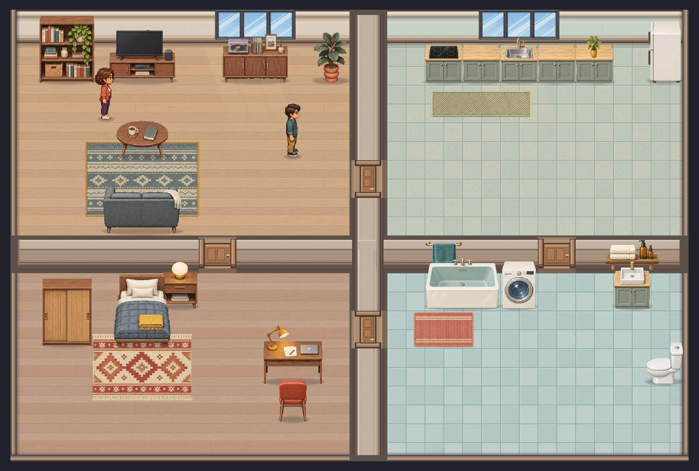

# Starter Home 现代像素公寓

人物、家具和墙面使用统一的俯视角度，从南侧看向公寓。客厅用电视、茶几和朝北的沙发围出休息区；卧室的椅子朝向书桌，床头柜紧邻床。灶台、水槽和备餐台沿厨房北墙排列；浴缸和洗衣机沿浴室上墙摆放，台盆在门的另一侧。冰箱和马桶背靠东墙、正面朝西，角色在西侧相邻格操作。四个门口均保留通路。

| 图集 | 用途 | 规格 |
| --- | --- | --- |
| [tiles.png](../../../plugins/home-objects/assets/modern-pixel/tiles.png) | 四种地面材质、墙体、门、外边线和窗光 | 地面每种四个 96×96 变体；墙体含 16 种邻接组合；门含横竖开关帧 |
| [furniture.png](../../../plugins/home-objects/assets/modern-pixel/furniture.png) | 家具、洁具、窗与小件 | 包含沙发背面、椅背和朝西的冰箱及马桶；落地件按实际占地定位，窗用上边居中 |
| [textiles.png](../../../plugins/home-objects/assets/modern-pixel/textiles.png) | 客厅地毯、卧室地毯、厨房走毯、浴室脚垫 | 四张俯视织物，以摆放格中心定位 |
| [alice.png](../../../plugins/starter-agents/assets/modern-pixel/alice.png)、[bob.png](../../../plugins/starter-agents/assets/modern-pixel/bob.png) | 穿现代日常服装的角色精灵 | 每人 4×4 帧；每帧 144×168，四行依次朝南、北、西、东 |

图集清单中的 `pixelsPerTile: 96` 只控制美术坐标。模拟仍用原来的 `tileSize: 16` 和格坐标。地图起始时显示全景，右下角可放大至全景的 4 倍。放大后可拖动地图，键盘焦点在地图上时也可用方向键平移。缩小使用多级采样抑制纹理闪烁，放大使用最近邻采样保留像素边缘。

新增美术时，先在[静态图集清单](../../../plugins/home-objects/assets/asset-manifest.json)登记裁剪框，再在 [Starter Home 场景](../../../content/worlds/starter-home/world.json)中摆放。地毯、挂饰等是纯装饰；落地家具使用[家具插件](../../../plugins/home-objects/src/objects/fixed-furniture.ts)声明的占地，寻路会绕开。实体按脚底所在行排序，沙发、床和浴缸的美术锚点按各自的占地调整。墙段以四邻接方向拼接，门画面读取公开开关状态，地面变体由格坐标稳定选取。

家具、窗、织物和角色原稿使用项目指定的生图 API，通过 imagegen CLI 请求 `gpt-image-2`。[生成提示词](modern-pixel-prompts.jsonl)包含家具转向用的参考图编辑：输入由四件家具的朝南原稿拼成。96 像素版直接从原稿重裁，保留织物、五金和服装细节，并为落地家具和人物补了接触阴影。地面、墙体和门在新尺寸下重绘，角色的互动手势在最终帧尺寸下修整。

新版布局使用场景 ID `starter-world-modern-pixel`。已有存档保留在原文件；要试新版场景，请为 `GOD_SIM_DATABASE` 另选一个路径。
